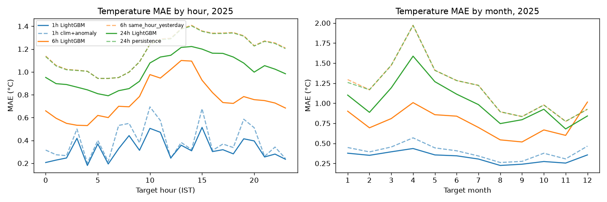
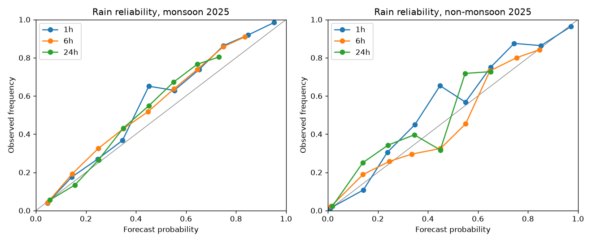
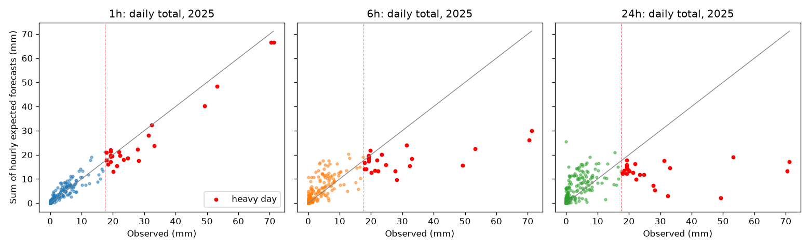

# Weather Forecasting for Patna (ERA5)

Supervised models that forecast temperature and rain 1h, 6h and 24h ahead for one ERA5 grid cell near Patna, evaluated against strong baselines on a held-out year. This is a historical backtesting experiment on reanalysis data, not an operational forecast.

## Results on the held-out year (2025)

The configuration was frozen before 2025 was looked at (commit `d0ddb5a`), the final models were trained on 2011-2024, and 2025 was scored **once** (2026-11-24). The evaluation script refuses to run a second time.

Skill = 1 - model error / baseline error, against the **best simple baseline for each horizon**, chosen on the 2023-2024 validation years. Brackets are 95% intervals from resampling whole days (2000 draws).

| Target (metric) | 1h | 6h | 24h |
|---|---|---|---|
| Temperature (MAE) | **+17.6%** [15.8, 19.5] | **+35.6%** [31.8, 39.1] | **+14.5%** [11.6, 17.4] |
| Rain occurrence (Brier) | **+25.8%** [22.6, 28.8] | **+26.0%** [19.7, 32.3] | **+18.0%** [12.7, 23.3] |
| Rain amount (RMSE, all hours) | +15.2% [12.1, 18.1] | +7.4% [3.7, 10.4] | +2.1% [-1.6, 4.5] |

| Horizon | Best temperature baseline | MAE baseline → LightGBM | Rain baseline | Rain PR-AUC (LightGBM) |
|---|---|---|---|---|
| 1h | climatology + current anomaly | 0.395 → 0.325 °C | rain now | 0.898 |
| 6h | same hour yesterday | 1.185 → 0.763 °C | seasonal probability | 0.746 |
| 24h | persistence | 1.182 → 1.010 °C | seasonal probability | 0.682 |

- Temperature and rain occurrence beat the best baseline at every horizon, with intervals well clear of zero.
- Rain **amount** is weak: small gains at 1h and 6h, and **no real skill at 24h** (the interval includes zero).
- A ridge regression on the same features loses to the best baseline at 1h and 6h. Most of the gain comes from the non-linear model, not the features alone.
- Results by season (monsoon June-September vs the rest) and on heavy-rain days are in `headline.csv`, produced by the evaluation script, and on the dashboard.

### Year-to-year variation (rolling origin)

One test year is one sample, so the frozen recipe was also re-run year by year (added after the test run, for reporting only; nothing was re-tuned). For each year from 2019 to 2025, the models were trained on all earlier years and scored on that year. Skill vs the same best baselines:

| Target | h | 2019 | 2020 | 2021 | 2022 | 2023 | 2024 | 2025 | Mean ± SD |
|---|---|---|---|---|---|---|---|---|---|
| Temperature (MAE) | 1h | 16.7% | 16.3% | 15.0% | 15.6% | 15.0% | 15.9% | 17.6% | 16.0 ± 0.9% |
| | 6h | 36.2% | 35.4% | 34.3% | 30.6% | 30.3% | 33.8% | 35.6% | 33.8 ± 2.4% |
| | 24h | 12.3% | 13.8% | 13.0% | 13.3% | 9.8% | 9.3% | 14.5% | 12.3 ± 2.0% |
| Rain occurrence (Brier) | 1h | 29.0% | 29.2% | 30.3% | 25.6% | 27.0% | 28.4% | 25.8% | 27.9 ± 1.8% |
| | 6h | 23.4% | 18.5% | 27.3% | 22.6% | 30.7% | 22.2% | 26.0% | 24.4 ± 4.0% |
| | 24h | 11.1% | 10.2% | 13.9% | 13.9% | 20.5% | 13.5% | 18.0% | 14.4 ± 3.6% |
| Rain amount (RMSE) | 1h | 10.8% | 11.2% | 5.8% | 19.3% | 11.6% | 12.1% | 15.2% | 12.3 ± 4.2% |
| | 6h | 5.4% | 2.1% | 9.0% | 5.3% | 4.4% | 4.2% | 7.4% | 5.4 ± 2.2% |
| | 24h | 1.6% | 0.9% | 2.3% | 2.5% | 2.7% | 1.4% | 2.1% | 1.9 ± 0.6% |

- Temperature and rain occurrence beat the best baseline in **every one of the 7 years** at every horizon.
- **2025 was a favourable year** for temperature: the best of the 7 at 1h and 24h. That explains most of the "test beat validation" gap. Expect roughly 16% / 34% / 12% in a typical year, not the 2025 figures.
- 24h rain amount stays at about 2% in every year, and its interval includes zero in most of them, so the "no real skill at 24h" conclusion holds.
- Caveat: only 2025 is fully out-of-sample. 2019-2022 were the tuning folds and 2023-2024 were used to choose the baselines, so those years lean slightly in the model's favour.

### Where the models go wrong (error analysis)



- **Temperature:** errors peak in the late morning and afternoon (10-16 IST), and April is the hardest month. In December the 6h model is *worse* than the baseline (MAE 1.01 vs 0.93 °C, warm bias +0.3 °C), probably because of fog and cold spells. The worst single errors cluster on a few days (e.g. 2025-04-10 afternoon, 2025-06-04, 2025-12-29/30) that look like thunderstorm and fog events. That is a guess from the data and hasn't been checked against weather reports.
- **Rain probability:** under-confident in the monsoon. The mean forecast is 0.41-0.44 while it rained in 48.5% of monsoon hours. I didn't recalibrate it, because that would be a change made after seeing the test year.



- **Heavy-rain days** (24 days with at least 17.5 mm): the models catch *that* it will be a wet day, but under-forecast *how* wet as lead time grows. The forecast total is 89% / 61% / 43% of the observed total at 1h / 6h / 24h. At 6h, 23 of the 24 heavy days still got a forecast of at least 10 mm.



## Live test (in progress)

To fix the biggest limitations (backtest only, no comparison with weather services), the frozen models now also run **live**:

- **Every hour**, a GitHub Actions workflow in [weather-patna-live-log](https://github.com/shashwatsrv/weather-patna-live-log) runs `src/live/log_forecasts.py`, pinned to the frozen code. It fetches the last 3 days of weather for the same grid cell from Open-Meteo's ECMWF IFS feed. ERA5 itself arrives about 5 days late, so it can't be used live. The script builds features with the same code as training and logs the LightGBM forecasts for 1h, 6h and 24h ahead.
- **In the same row**, it logs the best baselines, plus ECMWF IFS and GFS forecasts for the same valid times, as issued at that moment.
- **Once ERA5 catches up**, `src/live/score_live.py` scores everything against it. A weekly workflow does this, and the log, scores and models are all kept in that repo.

This is a prospective test: none of these hours existed when the configuration was frozen. Results will be added once there are a few months of data. Two things to keep in mind when reading them:

- **IFS has a built-in advantage.** It comes from the same model family as ERA5, the data everything is scored against.
- **Live inputs differ from the training inputs**, which will probably cost the LightGBM models some skill.

The weather-service comparison will be reported as it comes out, whichever way.

## Method in brief

- **Data:** hourly ERA5 for one grid cell, 2011-2025. Stored in UTC, converted to IST for features and reporting. The precipitation value stamped *t* covers the hour ending at *t*.
- **Split (chronological):** train 2011-2022, validate 2023-2024, test 2025. Rows whose target crosses a split boundary are dropped.
- **Features (38, past data only):** current weather, temperature and humidity lags up to 48h, pressure changes, rain lags and rolling sums, and cyclic hour and day of year.
- **Baselines:**
  - Temperature: persistence, same hour yesterday, climatology, and climatology plus the current anomaly.
  - Rain: rain now, and seasonal probability.
  - Rain amount: zero, rain now, and climatological mean.
  - The best one per horizon on validation is the bar to beat.
- **Models:** LightGBM, one model per horizon and target (direct forecasting).
  - Temperature predicts the change from the current temperature.
  - Rain is two-stage: P(rain ≥ 0.1 mm) × the amount if it rains. The amount model is fitted on wet hours with a log target, plus a Duan smearing correction.
- **Tuning:** walk-forward cross-validation inside the training years (validating on 2019, 2020, 2021 and 2022, each trained on earlier years only). The smearing factors were chosen the same way.
- **Metrics:**
  - Temperature: MAE.
  - Rain occurrence: Brier score, plus PR-AUC.
  - Rain amount: RMSE over all hours, plus bias.
  - Rain occurrence isn't scored on the heavy-day slice, because that slice is defined by the outcome.

## Limitations

- **Reanalysis, not observations.** ERA5 is a model-based reconstruction of the weather on a ~28 km grid. It smooths local extremes, especially convective rain, so this is not a forecast of what a Patna rain gauge would record.
- **Baselines, not weather services.** The models are compared with simple baselines, not with operational forecasts. I looked for a fair comparison and found no long archive of as-issued forecasts at 1h/6h/24h leads that overlaps the training years. Short archives (from 2021-2024) and stitched short-lead series exist, but they would have meant reusing the test year or a biased comparison. So this project makes no claim about beating a weather service.
- **The results above are a backtest.** Their inputs are ERA5 values, which in reality are only published with a delay of about 5 days. The live test above uses real-time inputs instead. It has only just started, so there are no live results yet.
- **Test skill came out higher than validation skill** (temperature +17.6/35.6/14.5% on 2025 vs +15.3/31.6/9.1% on 2023-2024). Two likely reasons: the final models had two more recent training years, and 2025's baselines were a bit harder to beat. A leakage audit found nothing: the test path is the same code as the validation check, and fit/score separation is asserted. The rolling-origin results show the bigger reason: 2025 was simply a good year for the model, at the top of the 2019-2025 range for temperature.
- **One grid cell, one year of test.** Nothing here shows the approach transfers to other locations.
- **Known weak spots** (see the error analysis): rain amounts at 24h, heavy-rain totals, December fog, and under-confident monsoon probabilities.

## Reproduce

```powershell
python -m venv .venv
.venv\Scripts\pip install -r requirements.txt
$env:WEATHER_DATA_DIR = "D:\datasets\weather-patna"   # any folder outside the repo
.venv\Scripts\python -m src.data.download_era5
.venv\Scripts\python -m src.data.era5_data_check
.venv\Scripts\python -m src.features.build_features
.venv\Scripts\python -m src.evaluation.baselines
.venv\Scripts\python -m src.models.tune_cv
.venv\Scripts\python -m src.models.rain_amount_correction
.venv\Scripts\python -m src.evaluation.evaluate_test            # check on 2023-2024
.venv\Scripts\python -m src.evaluation.evaluate_test --final    # train 2011-2024, score 2025 once
.venv\Scripts\python -m src.evaluation.error_analysis
.venv\Scripts\python -m src.evaluation.rolling_origin          # year-by-year skill, 2019-2025
.venv\Scripts\python -m src.models.save_final_models           # save frozen models for live use
.venv\Scripts\python -m src.live.log_forecasts                  # one live forecast (run hourly)
.venv\Scripts\python -m src.live.score_live                     # score the live log against ERA5
.venv\Scripts\python -m streamlit run app\app.py                 # backtest dashboard
```

The frozen hyperparameters, smearing factors and baselines are in `src/models/frozen_config.py`, so `tune_cv` and `rain_amount_correction` only need re-running to check how they were chosen. LightGBM results can differ slightly between versions and machines. `save_final_models` checks that the saved models reproduce the frozen 2025 predictions before saving them. Live logging runs on GitHub Actions in the log repo. To log from your own machine instead, point Windows Task Scheduler at `scripts\log_forecast.cmd`.


## Data and attribution

- **Data:** ERA5 hourly reanalysis (2011-2025) for the 0.25° grid cell at 25.5°N, 85.25°E, about 15 km from central Patna. It was downloaded through the [Open-Meteo](https://open-meteo.com/) Historical Weather API with `models=era5`. The raw data is not included in this repository.
- **Changes made:** the data was resampled into lagged features, daily totals and forecast targets, and used to train and evaluate models. Every number and plot in this project is derived from the data, not raw ERA5 values.
- [Weather data by Open-Meteo.com](https://open-meteo.com/), licensed under [CC BY 4.0](https://creativecommons.org/licenses/by/4.0/).
- Contains modified Copernicus Climate Change Service information 2026. Neither the European Commission nor ECMWF is responsible for any use that may be made of the Copernicus information or data it contains.
- **Dataset:** C3S (2018). *ERA5 hourly data on single levels from 1940 to present* [Dataset]. Copernicus Climate Change Service (C3S) Climate Data Store (CDS). https://doi.org/10.24381/cds.adbb2d47 (licence: [CC BY 4.0](https://creativecommons.org/licenses/by/4.0/)).
- **Reanalysis reference:** Hersbach, H., et al. (2020). The ERA5 global reanalysis. *Quarterly Journal of the Royal Meteorological Society*, 146, 1999-2049. https://doi.org/10.1002/qj.3803
- **API citation:** Zippenfenig, P. (2023). *Open-Meteo.com Weather API* [Computer software]. Zenodo. https://doi.org/10.5281/ZENODO.7970649

Neither Open-Meteo, ECMWF nor the Copernicus programme endorses this project.
